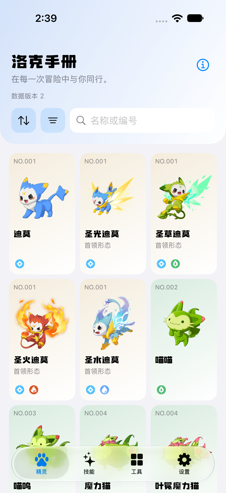
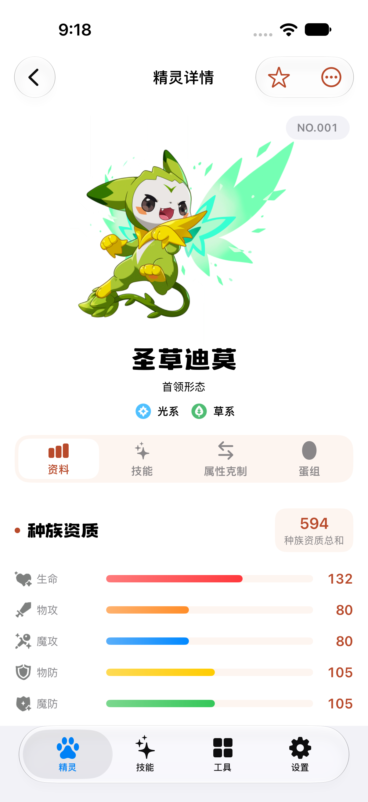
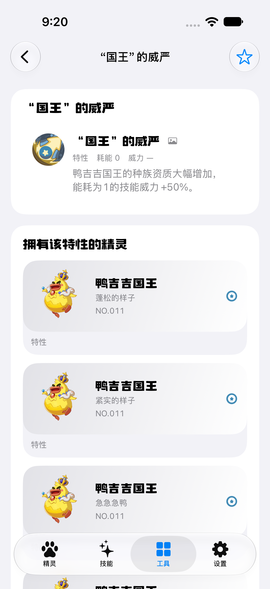

# 洛克手册

[](https://github.com/godwhere/roco-handbook/actions/workflows/offline-validation.yml)

一款《洛克王国：世界》的原生 iOS 资料 App，独立、非商业、离线优先。客户端使用 Swift 与 SwiftUI，支持 iOS 15 及以上版本；Python 数据工具将经过校验的 BWIKI 固定版本数据转换为结构化 SQLite 图鉴，提供精灵、技能、特性、进化、属性克制、活动和个性化收藏等查询能力。

App 首次启动不需要下载数据，也不会在浏览过程中访问 Wiki。完整图鉴、图片和字体随安装包提供；后续数据更新必须由用户在设置页主动触发，并经过签名、哈希、压缩包、数据库和版本兼容性校验后才能启用。

> 当前原生开发版本为 `1.2.0`，构建号 `3`。项目尚未发布到应用商店，真机、正式签名、商店上传和审核仍属于独立的发布验收环节。

## 项目展示

[公开源码](https://github.com/godwhere/roco-handbook)。以下为原生 SwiftUI 客户端的 iOS 模拟器运行截图，分别展示图鉴、精灵资料和特性关联；不使用历史 Flutter 界面代表当前原生版本。

<p>
  
  
  
</p>

源码与游戏数据、图片的权利边界不同，第三方内容仍按 [数据署名与依赖许可](licenses/) 中的说明使用。

## 项目概览

| 项目 | 当前实现 |
| --- | --- |
| 客户端 | [`ios/`](ios/README.md) 中的 Swift / SwiftUI 原生 iOS App，支持 iOS 15 及以上 |
| 数据规模 | 633 个具体精灵形态、468 个图鉴条目、825 个技能、312 份技能学习表、279 组进化关系 |
| 数据存储 | 只读 `catalog.db` 与独立可迁移 `user.db` |
| 离线资源 | 精灵立绘、异色立绘、技能与特性图标、属性与分类图标、活动图标、时装预览和 Wiki 风格字体 |
| 本地化 | 设置中可选择跟随系统、简体中文或 English；其他语言回退到英文，游戏术语以冻结的 Wiki 词汇为准 |
| 平台视觉 | 原生 SwiftUI 导航与系统材质、品牌化图鉴标题、系别主题卡片、动态字号 |
| 数据更新 | 设置页主动检查，使用 GitHub Releases 分发由 Ed25519 签名清单认证的完整图鉴包 |
| 自动化验证 | Python 数据契约测试、Swift XCTest、iOS UI 测试与 GitHub Actions 离线持续集成 |

## 核心功能

### 精灵图鉴

- 按名称、称号、别名或图鉴编号搜索具体精灵形态。
- 支持图鉴编号、名称、物攻、魔攻和速度排序。
- 支持系别、阶数、主形态／地区形态／首领形态、归属赛季和有无异色的组合筛选。
- 精灵和技能筛选采用多列短按钮，属性与技能分类优先展示离线图标；支持多选、勾选反馈和一键重置。
- 首页头图延伸至状态栏背景，排序、筛选与搜索位于同一行。
- 默认每行三只精灵，也可在设置中选择双列卡片或紧凑横向列表，布局选择会保存。三种布局共享系别主题背景，展示完整立绘、形态副标题、`NO.<编号>`、系别图标和详情入口。
- 有异色资源的精灵可在详情页切换原始立绘与异色立绘。
- 进入详情先展示大立绘，向下浏览时收为紧凑头图，回到顶部恢复；资料、技能、属性克制与蛋组使用图标标签切换。
- 名称、形态与属性在头图信息区居中；滚动内容限制在导航栏下方，顶部使用与页面一致的实色背景。

### 精灵详情

- 立绘头图使用与页面一致的自适应底色，下方提供“资料、技能、属性克制、蛋组”四个页签；资料页以彩色条展示六项种族资质，并提供特性、已有蛋重资料与基本信息。
- 展示六项种族资质、完整数据下的总和、身高、体重、回顾洛克贝、星光值和首领进化状态。
- 区分精灵技能、血脉影响和可学技能，支持名称、系别或描述搜索，以及技能类型与属性筛选，保留各项学习条件。
- 进化分支可直接跳转到对应精灵详情，不根据名称或编号后缀推断关系。
- 属性克制页可切换进攻方与防守方；根据冻结的属性关系表计算单系和双系受到的伤害倍率。
- 蛋组页展示已收录的组别，可跳转浏览同组精灵；未收录的资料明确提示缺失。
- 右上角更多菜单提供进化、个人收藏／笔记和来源资料入口，头图提供收藏与异色切换按钮。

### 技能图鉴

- 独立展示可学习技能，特性通过精灵关系和特性图鉴访问。
- 支持正常文字输入查询，以及技能类型、技能标签和技能属性组合筛选。
- 技能卡默认双列，可切换三列或保留效果说明的详细模式；设置会保存，并在技能图鉴、特性图鉴和精灵技能页共用。
- 紧凑卡左侧展示放大的技能图，右侧纵向排列名字和属性／威力，左右模块居中对齐；图上显示耗能，精灵技能仅在有记录时于右下角显示学习等级。点击可阅读完整说明和当前精灵的学习条件。
- 技能详情保留来源修订、关联精灵和收藏入口。
- 技能详情以立绘卡片展示可学习技能的精灵及特性归属，保留编号、形态、属性和每条学习条件，点击可进入具体精灵。

### 图鉴工具

工具页参考 Wiki 的图片入口，以赛季大卡、特性与蛋组小卡组成错落布局，其余工具使用紧凑图文行，提供八个离线入口：

| 工具 | 功能 |
| --- | --- |
| 打击面计算器 | 最多选择五种攻击属性，查看克制覆盖、共同被抵抗的属性和中性目标；附冻结属性表来源 |
| 赛季档案 | 按图鉴中保存的归属赛季查看精灵 |
| 特性图鉴 | 浏览已收录特性及其关联精灵 |
| 孵蛋组别 | 使用正常文字搜索精灵，并按一个或多个孵蛋组别筛选 |
| 游戏描述 | 查询 54 条状态、印记、天气、战斗动作和规则说明 |
| 活动时间轴 | 按月份、分类和状态浏览 552 条活动记录 |
| 穿搭灵感 | 搜索与筛选 124 套时装，并切换 248 个男女款预览 |
| 个人收藏 | 管理精灵与技能收藏、图鉴收集标记和本地笔记 |

### 个人数据

- 收藏、收集状态和笔记保存在设备私有目录中的 `user.db`。
- `user.db` 与可替换的图鉴数据库完全分离，图鉴更新、恢复或回滚不会覆盖个人数据。
- 图鉴对象在新版本中缺失时，个人收藏仍保留保存时的名称快照和笔记。
- 当前版本不提供账号、云同步或跨设备个人数据迁移。

### 原生 iOS 界面

- 使用 SwiftUI 的系统标签栏、导航、菜单、表单和筛选页；iOS 16 及以上使用 `NavigationStack`，iOS 15 使用 `NavigationView`。
- 系统组件随 iOS 版本呈现对应导航材质；密集图鉴、说明和资料面板保持清晰的实体背景。
- 主界面提供精灵、技能、工具和设置四个入口，列表末尾可滚动到导航栏之外；动态字号增大时精灵网格可切换为单列。
- 设置的外观区域提供语言菜单，可选择跟随系统、简体中文或 English，选择后界面立即切换并保留在设置页；重启和恢复内置图鉴后仍记住选择。游戏条目的名称和说明保留上游原文。
- 工具页使用雾蓝灰底、深蓝与淡紫色块和游戏原图；设置页使用米白面板、深色外观标题区及少量金色细节，支持深色模式。布局选项带有明确标签，辅助功能大字号时使用易于阅读的菜单选择，工具入口改为可自然增高的纵向行。

## 技术架构

项目将开发期数据生产与运行期离线查询分开，App 不直接消费 Wiki 原始字段，也不在运行时解析 Lua。

```text
开发期数据链路

BWIKI 固定修订响应
        ↓
来源身份、修订号与内容哈希校验
        ↓
只解析 data-only Lua 的安全解析器
        ↓
字段适配、引用闭包检查与稳定 ID 注册表
        ↓
规范化 JSON
        ↓
Catalog Builder
        ↓
版本化 catalog.db + manifest + attribution

运行期数据链路

SwiftUI 页面
    ↓
Controller / Domain DTO
    ↓
Repository
    ├── 只读 catalog.db：精灵、技能、进化和图鉴工具
    └── 独立 user.db：收藏、收集状态、笔记和设置
```

SwiftUI 页面只通过 Repository 和领域 DTO 读取数据。SQLite 连接、文件复制、哈希计算和完整性检查不会进入视图构建过程；所有搜索输入使用参数绑定，排序字段由受控枚举选择。

## 关键工程设计

### 1. 可追溯的数据生产管线

- 抓取前冻结整组上游修订，按修订号读取正文并在结束后复核，避免混用更新期间的不同版本。
- 自定义解析器只接受受支持的 data-only Lua 语法，不执行下载的 Lua，也不调用 `require`。
- 对空响应、解析失败、未知字段、引用缺失和身份冲突采取失败关闭策略，不会把失败误写成空版本。
- 原始修订、上游数字 ID、空值、未知字段和需要人工复核的冲突会被保留，方便回溯。

### 2. 稳定身份与关系完整性

- 使用独立的 `handbook_id`、`pet_id` 和上游数字 ID，避免把图鉴条目、具体形态和源数据编号混为一体。
- 当前 NRC 注册表锁定 1,926 个精灵、图鉴和技能身份，并检查缺失、复用和未审核变更。
- 图鉴编号、默认展示顺序和归属赛季由来源数据直接提供。
- 原生技能、血脉技能、技能石技能和传奇技能关系分别保留，避免在规范化时相互覆盖。
- 上游技能编号重排时使用绑定具体快照与旧数据库哈希的审查映射；第 3 版保留全部既有本地身份、学习条件和收藏引用。

### 3. 图鉴与个人数据双数据库

- `catalog.db` 是不可变、版本化、只读的内容数据库，可以整体替换和回滚。
- `user.db` 使用独立结构和迁移流程，只保存个人数据，图鉴安装器无权重建或删除它。
- Catalog 打开时启用 SQLite 只读和 `query_only`，同步查询由后台 actor 仓库串行执行。

### 4. 可恢复的完整图鉴更新

- App 启动时串行完成图鉴选择、校验和 Repository 创建，避免页面读取到半安装状态。
- 新图鉴先写入调用方拥有的暂存文件，通过全部校验后再切换活动指针。
- 保留当前版本和一个已验证的上一版本；激活后打开失败会自动回滚。
- 远端更新使用 Ed25519 验证发布者身份，并检查固定 HTTPS 主机、版本兼容、防重放、文件长度、SHA-256、ZIP 结构、SQLite 完整性、外键和探针查询。
- 当前只支持完整 Catalog 包，不支持逻辑增量补丁、后台更新或 App 二进制更新。

### 5. 完整离线视觉资源

- 607 张去重原始精灵立绘覆盖全部 633 个具体形态。
- 195 张去重异色立绘覆盖 197 个可切换引用。
- 774 个技能或特性图标、35 个属性与分类图标随 App 打包。
- 图鉴视觉资源清单包含 1,611 个文件、1,690 个引用和 126,980,986 字节，并记录来源与本地哈希。
- 工具资源包含 59 个活动图标和 248 个时装预览，共 307 个文件、13,961,806 字节。
- 标题使用冻结的 Wiki 字体，数值使用系统等宽数字；长说明和输入框保留平台字体及缺字回退。

### 6. 自动化质量门禁

- Python 测试覆盖来源契约、安全解析、规范化、身份稳定、引用闭包、数据库构建、资源清单和发布检查。
- Swift 测试覆盖 Repository、双数据库生命周期、更新与恢复、搜索筛选、具体形态、来源关系、离线图片及签名验证；iOS UI 测试覆盖实际导航和个人数据流程。
- GitHub Actions 分别在 Ubuntu 和 macOS 上验证 Python 数据管线及原生 Swift 客户端，不使用 Wiki、签名私钥或商店凭据。
- 发布检查会拒绝 SQLite 事务边车、占位元数据、错误覆盖声明、哈希漂移、来源锁不一致、未审核删除和结构探针失败。

## 技术栈

| 层级 | 技术 |
| --- | --- |
| iOS 客户端 | Swift、SwiftUI、Xcode |
| 本地数据 | 系统 SQLite、参数绑定、JSON |
| 数据工具 | Python 3.11、标准库单元测试、确定性构建脚本 |
| 安全更新 | Ed25519、SHA-256、规范化 Base64url、ZIP 完整包 |
| 平台能力 | iOS、应用私有存储、Swift Concurrency、Foundation、CryptoKit |
| 工程质量 | XCTest、XCUITest、原生构建、GitHub Actions |

## 仓库结构

```text
ios/                    当前 Swift/SwiftUI 客户端、Xcode 工程和原生测试
app/                    不可变离线资源与历史客户端源码
config/                 来源、身份、术语、关系和资源清单配置
data/raw/               本地冻结响应；正文忽略提交，来源锁可追溯
data/normalized/        确定性的 Catalog 构建输入
data/release/           不可变版本数据库、清单、署名和构建报告
deploy/                 静态资料镜像的服务器配置与运行说明
docs/                   技术规格、决策记录、功能文档、证据和阶段报告
licenses/               数据署名边界和运行依赖许可清单
release/                发布候选检查、说明和已知限制
schemas/                Catalog、User 和远端清单的规范结构
tests/                  Python 离线契约与构建回归测试
tools/                  BWIKI 导入、规范化、构建、签名和发布检查工具
.github/workflows/      无凭据离线持续集成
```

## iOS 开发与运行

开发环境为 macOS、Xcode（含 iOS SDK 和可用的模拟器运行时）及 Python 3.11。Xcode 构建阶段会使用 `python3` 准备离线资源。

在仓库根目录打开原生工程：

```bash
open ios/RocoHandbook.xcodeproj
```

1. 在 Xcode 中选择共享的 `RocoHandbook` Scheme。
2. 选择一个可用的 iOS 模拟器作为运行目标。
3. 点击 Run 或按 `⌘R`，构建并启动 App。

App 构建时会自动从 `app/assets/` 打包冻结资源，首次启动安装内置图鉴。普通浏览不需要网络；设置页中的主动更新操作才会连接固定的 GitHub Releases 地址。

真机运行需要在 Xcode 中配置自己的签名团队，相关验收仍待完成。工程结构和 UI 测试说明见 [原生客户端说明](ios/README.md)。

## 本地验证

从仓库根目录运行数据与项目契约测试：

```bash
PYTHONDONTWRITEBYTECODE=1 PYTHONPATH=tools python3 -m unittest discover -s tests -p 'test_*.py'
```

验证不可变 Catalog 发布内容：

```bash
PYTHONDONTWRITEBYTECODE=1 PYTHONPATH=tools python3 tools/release/check_catalog.py \
  --release data/release/3
```

验证原生客户端：

```bash
swift test --package-path ios --scratch-path /tmp/roco-handbook-spm
xcodebuild -project ios/RocoHandbook.xcodeproj -scheme RocoHandbook \
  -destination 'generic/platform=iOS Simulator' \
  -derivedDataPath /tmp/roco-handbook-xcode CODE_SIGNING_ALLOWED=NO build
```

iOS UI 测试命令见 [原生客户端说明](ios/README.md)。

## 当前状态与验收边界

- Swift / SwiftUI 客户端位于 `ios/`，提供精灵、技能、八个图鉴工具、收藏、收集标记、笔记和设置功能。数据工具使用 Python，当前 Catalog 数据版本为 3，数据库结构由两份规范 SQL 定义。
- 应用标识为 `world.roco.rocoHandbook`，个人数据位于 `Library/Application Support/user/user.db`；图鉴恢复与更新不会覆盖个人数据库。
- 支持签名完整图鉴包校验和固定 GitHub Releases 传输；正式数据包的签名、托管和在线更新验证属于独立验收环节。
- 腾讯云备用源已完成服务器内部部署和资料包传输验收；`time9.site` 尚未备案，公网 HTTPS 与 App 自动切换尚未启用。部署边界和后续步骤见 [服务器运行说明](deploy/catalog-mirror/README.md)。
- 打击面计算器见 Phase 15 报告，语言切换见 Phase 14，当前工具与设置视觉见 Phase 13；原生基础实现见 Phase 9，图鉴、活动与时装更新及身份兼容见 Phase 10。
- 真机安装、既有安装的签名升级、iOS 15 运行、VoiceOver、低存储与崩溃耐久性、正式归档、商店上传、审核和发布尚未完成。

## 相关文档

- [原生 iOS 开发说明](ios/README.md)：当前客户端结构、资源打包与原生测试命令。
- [技术规格基线](docs/technical-spec-v1.md)：项目范围、数据契约和阶段验收基础。
- [离线图鉴功能](docs/features/offline-catalog-browser.md)：搜索、筛选、详情和工具页行为。
- [个人数据](docs/features/personal-library.md)：收藏、收集标记、笔记和数据库隔离。
- [图鉴更新与恢复](docs/features/catalog-update-and-recovery.md)：安装、指针切换、回滚与清理边界。
- [独立图鉴更新](docs/features/independent-catalog-updates.md)：签名清单、GitHub Releases 和前台更新流程。
- [视觉与本地化](docs/features/localized-visual-handbook.md)：中文术语、图片、字体和页面呈现。
- [原生 iOS 决策](docs/decisions/ADR-0023-native-swift-ios-client.md)：Swift、平台范围及兼容边界。
- [Phase 9 实施报告](docs/implementation-reports/phase-9.md)：原生客户端与界面证据。
- [Phase 10 实施报告](docs/implementation-reports/phase-10.md)：最新来源内容、身份兼容、离线资源与验证边界。
- [Phase 11 实施报告](docs/implementation-reports/phase-11.md)：工具与设置的洛克手册风格、常规字号与辅助字号验收。
- [内容更新流程](docs/features/catalog-content-refresh.md)：冻结来源、审查映射与完整资料包构建。
