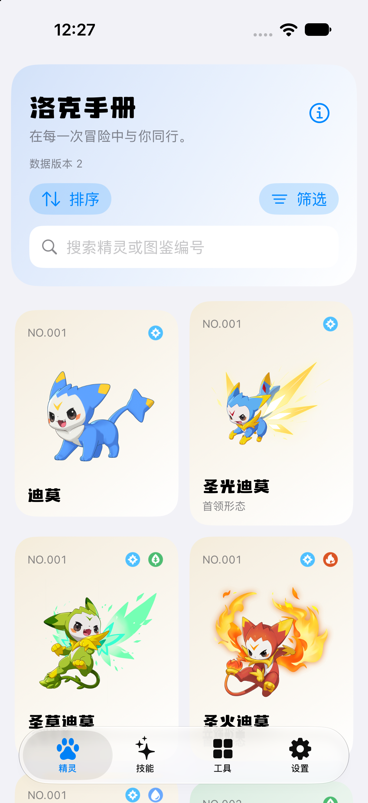

# Phase 9 native Swift iOS evidence

- Date: 2026-10-09
- Scope: [ADR-0023](../decisions/ADR-0023-native-swift-ios-client.md)
- Detailed results: [Phase 9 report](../implementation-reports/phase-9.md)

## Observed environment

Xcode 27.0, build `27A266a`; Swift 6.4; iOS SDK and simulator runtime 27.0. The native scheme targets iOS 15 and later with bundle ID `world.roco.rocoHandbook`, version `1.2.0`, and build `3`. No signing team is set.

A fresh `Roco Swift Migration` iPhone 18 Pro simulator (`59C3C5B8-DC7B-418A-84D7-8C0B165A5B8A`) was created for this invocation. Native UI tests create saved records only inside that simulator. Other simulators and existing personal databases were not reset or modified.

The previous iOS support-directory implementation was inspected in `path_provider_foundation` 2.6.0. It appends a bundle-ID directory on macOS but not iOS. The native client therefore uses the same `Library/Application Support/user/user.db` location. Literal old pointer/user-directory regression fixtures passed; this is automated compatibility evidence, not a signed physical upgrade result.

## Frozen data

The active data version remains 2, snapshot `snapshot-dad7cd7d5ce73236`. The 4,657,152-byte database has SHA-256 `dce0d3376611adc151f8e2abe1f74185d19c94f61a3d0d2fade98a188dae9d61`. Its 621 concrete forms, 466 handbooks, 824 skills, 311 Learnsets, and 273 evolution groups were queried through native repositories.

Both normative schemas, upstream source locks, normalized records, Catalog releases, and shared `app/assets/` files were unchanged. The Chinese provenance specification retained Git object `40c9d2be4ea84b02887433495f0716eb8c770985` from the phase baseline.

## Local acceptance

| Boundary | Observation |
| --- | --- |
| Python offline contracts | 109 tests passed, including bilingual native literal/error copy and frozen domain terms |
| Immutable release 2 validator | Passed; exact hash, metadata, schema, integrity, and reference checks |
| Mac-host Swift XCTest | 22 tests passed with no failures |
| Native simulator build | `BUILD SUCCEEDED`, unsigned generic simulator destination |
| Installed native UI | 4 UI tests passed with no failures on iPhone 18 Pro / iOS 27.0 |
| Diff and delivery scope | `git diff --check` passed; only Phase 9 allowlisted files included |

Final UI results are at `/tmp/roco-native-ui-tests-final.xcresult`. Full local logs are listed in the phase report. Test transport inputs are owned offline Ed25519/ZIP fixtures; they do not establish live update availability.

## Native Chinese Catalog capture

The 1206 × 2622 capture shows the installed native client, localized branded header, concrete-form grid, bundled creature illustrations, search, and system tab navigation. It contains real bundled Catalog data. It is simulator presentation evidence, not an App Store screenshot set or physical-device acceptance. Later source-attribution and update-progress refinements do not change this captured Catalog surface.

## Resolved local failures

Test-bundle signing under the Documents-backed checkout failed on resource-fork metadata. Temporary build roots under `/tmp` passed without changing host security settings. A test package architecture mismatch was corrected by selecting the active Debug architecture. Parent accessibility identifiers masked child controls in the initial UI run; removing those parent identifiers allowed direct control selection and the final four-test run passed. The Python CI assertion was adjusted to the new pinned-action inventory after removing Flutter setup.

## Unobserved layers

No BWIKI import, live signed update, network configuration change, signing-key operation, store-account configuration, archive export, upload, or publication occurred. Physical signed upgrade, iOS 15 execution, VoiceOver, low-storage/crash behavior, exhaustive localization, and hosted CI for this revision remain unrun. Historical Flutter/Android evidence is retained separately and does not prove native acceptance.
